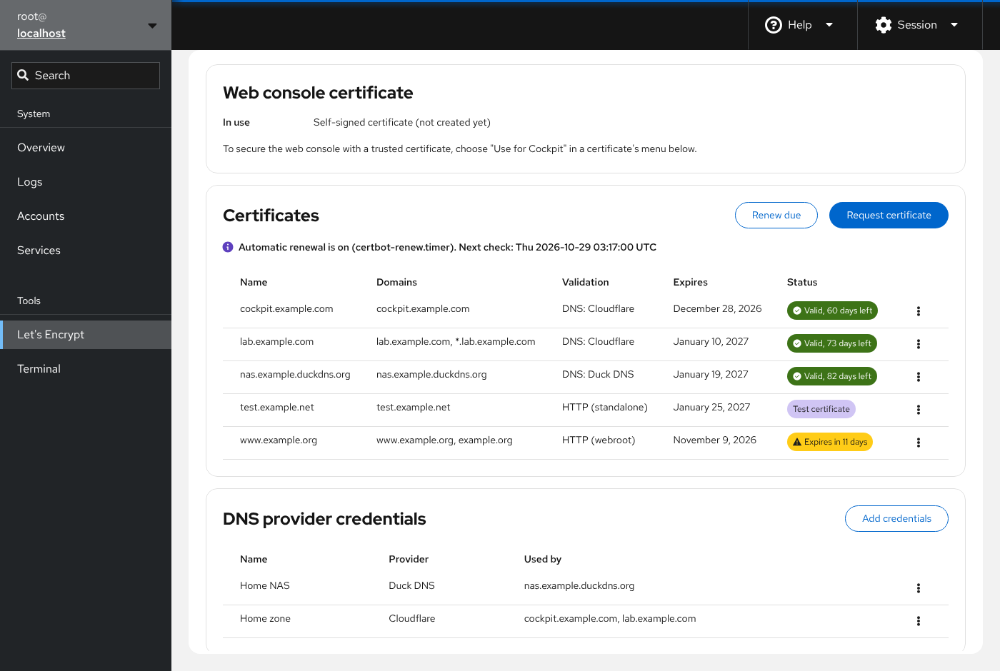
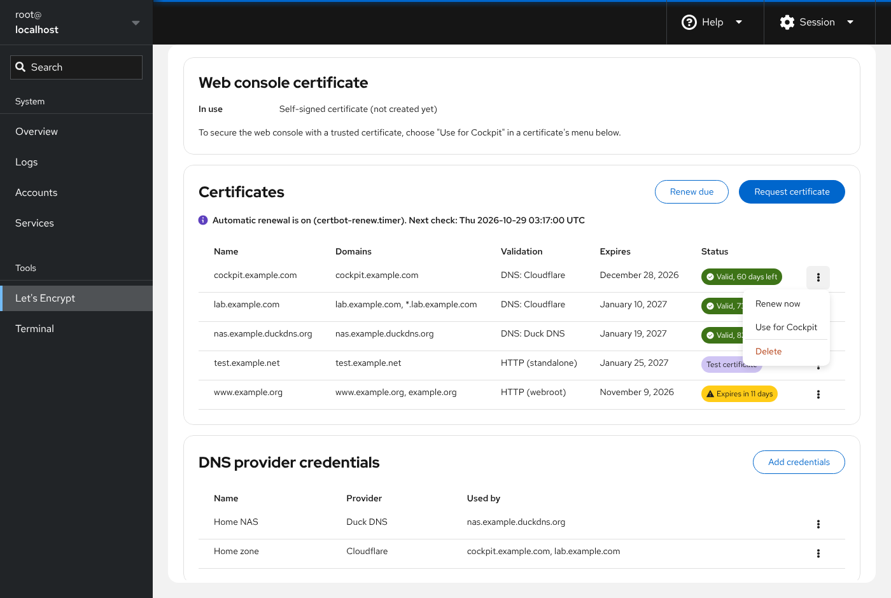
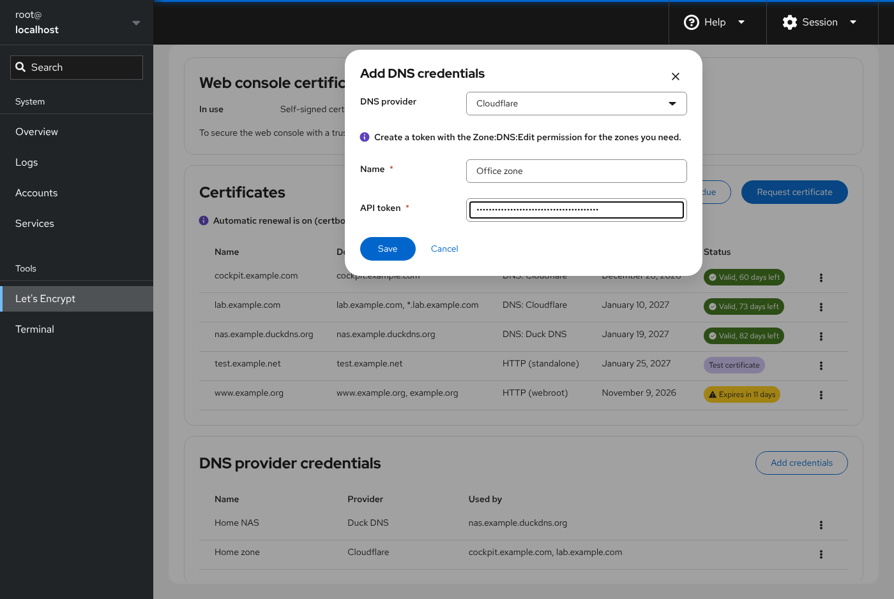
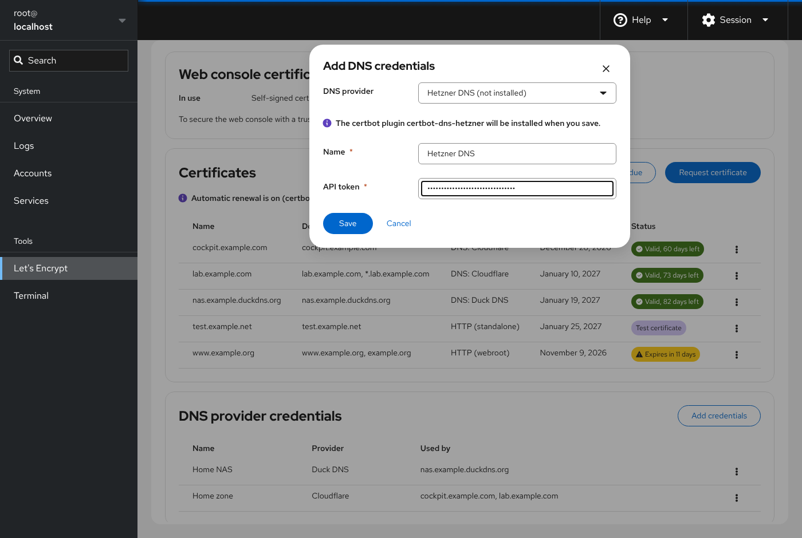
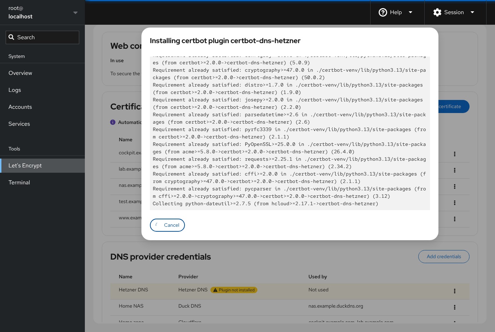
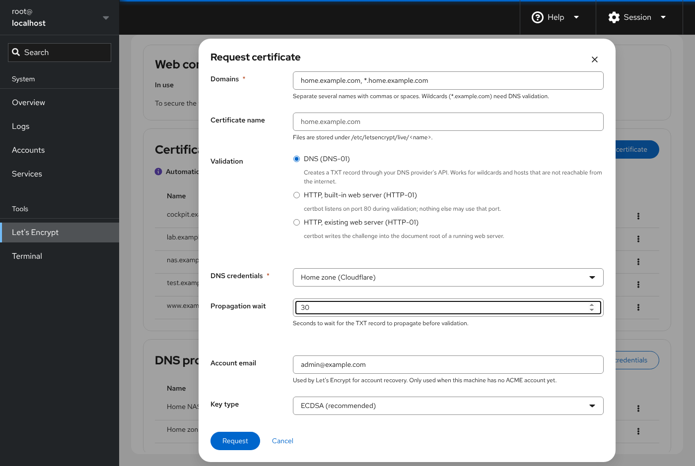
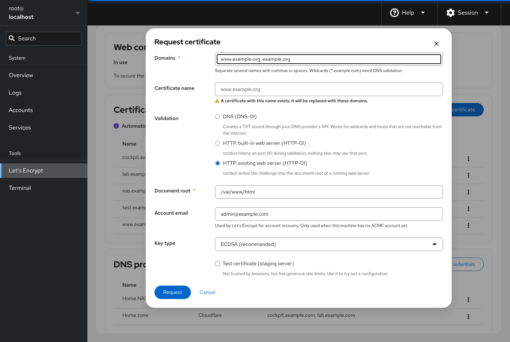
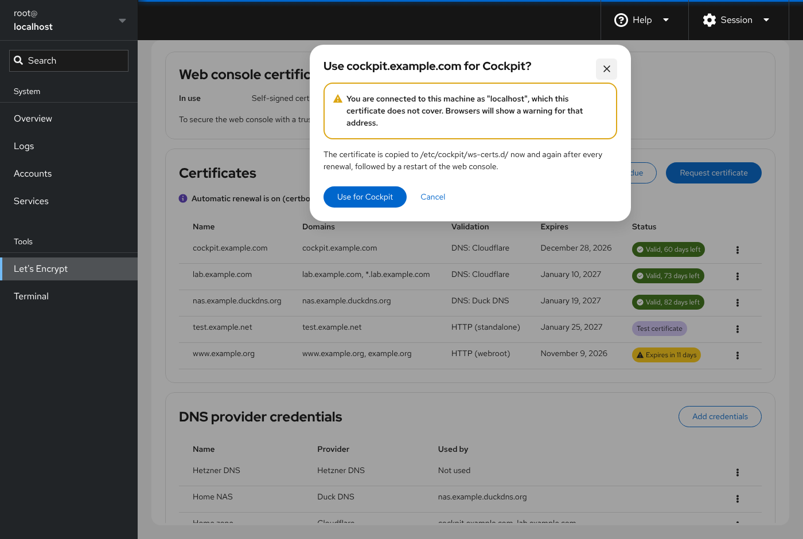
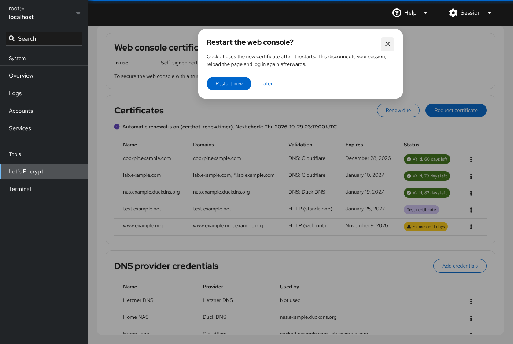
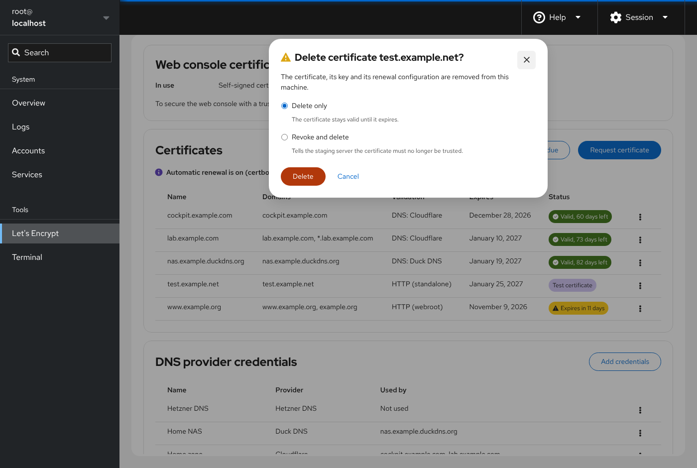

# User guide

This guide walks through every part of the Let's Encrypt page. The screenshots
come from a demo machine with example domains.

* [Opening the page](#opening-the-page)
* [The certificate list](#the-certificate-list)
* [Automatic renewal](#automatic-renewal)
* [DNS provider credentials](#dns-provider-credentials)
* [Requesting a certificate](#requesting-a-certificate)
* [Renewing a certificate](#renewing-a-certificate)
* [Using a certificate for Cockpit](#using-a-certificate-for-cockpit)
* [Deleting or revoking a certificate](#deleting-or-revoking-a-certificate)
* [Troubleshooting](#troubleshooting)

## Opening the page

The page is under **Tools → Let's Encrypt** in Cockpit's menu. certbot and its
files belong to root, so the page needs
[administrative access](https://cockpit-project.org/guide/latest/privileges.html).
If your session has limited access, the page asks you to turn it on with the
**Limited access** button in the top bar.

If certbot is not installed, the page offers to install it. On RHEL and its
rebuilds, certbot is in EPEL.

The page has three parts, from top to bottom:

* **Web console certificate**: which certificate Cockpit is using now.
* **Certificates**: the certbot certificates on this machine.
* **DNS provider credentials**: the API credentials that DNS validation uses.

## The certificate list

The list shows each certificate that certbot manages on this machine. That
includes certificates you created with certbot on the command line before
installing this module.

| Column | Meaning |
| --- | --- |
| Name | certbot's certificate name. Its files are in `/etc/letsencrypt/live/<name>/`. A blue **Cockpit** label marks the certificate the web console uses. |
| Domains | Every name the certificate covers, including wildcards. |
| Validation | How certbot proves you control the domains at renewal: *DNS: provider*, *HTTP (standalone)* or *HTTP (webroot)*. Read from certbot's renewal configuration. |
| Expires | The certificate's expiry date. |
| Status | **Valid, N days left**; **Expires in N days** when 21 days or fewer remain; **Expired**; **Test certificate** for certificates from the staging server, which browsers don't trust; **Invalid** when certbot can't read the certificate. |

Each row has a menu with the actions for that certificate:

* **Renew now**: renews the certificate right away, even if it isn't due yet.
* **Use for Cockpit**: makes the web console use this certificate. See
  [Using a certificate for Cockpit](#using-a-certificate-for-cockpit).
* **Delete**: deletes or revokes the certificate. See
  [Deleting or revoking a certificate](#deleting-or-revoking-a-certificate).

## Automatic renewal

Let's Encrypt certificates are valid for 90 days. certbot renews each one
when 30 days or fewer remain, provided something runs `certbot renew`
regularly. Distributions ship a systemd timer for that.

The line below the **Certificates** title shows the timer's state:

* **Automatic renewal is on (certbot-renew.timer). Next check: …**: renewal is
  taken care of.
* **Automatic renewal is off: … is not running**: click **Turn on automatic
  renewal**. This runs `systemctl enable --now` for the timer.
* **No certbot renewal timer found**: certbot was installed without a timer,
  for example with pip. Certificates only renew if a cron job runs
  `certbot renew`.

The page recognizes `certbot-renew.timer` (Fedora, RHEL), `certbot.timer`
(Debian, Ubuntu) and `snap.certbot.renew.timer` (snap).

**Renew due** in the card header runs `certbot renew` once, right now. It
renews only the certificates that are due, which is exactly what the timer
does.

## DNS provider credentials

DNS validation (DNS-01) proves that you control a domain by creating a
temporary `_acme-challenge` TXT record through your DNS provider's API. You
need it for:

* **wildcard certificates** (`*.example.com`), which Let's Encrypt issues only
  with DNS validation,
* **internal hosts** that the internet cannot reach on port 80, such as a NAS,
  a lab, or a machine behind NAT.

certbot needs an API credential for your DNS provider. Store it once under
**DNS provider credentials**, then pick it when you request a certificate.

### Adding credentials

Click **Add credentials**.

* **DNS provider**: the list contains all built-in providers, plus any other
  certbot DNS plugin installed on the machine. See
  [DNS providers](dns-providers.md) for what each provider needs.
* **Name**: a name you choose, such as *Home zone*. It is shown on the
  page and in the request dialog. You can keep several credentials for the
  same provider, for example one per account.
* **Credential fields**: they depend on the provider. For some providers, a
  hint below the provider says which permissions the token needs.

**Save** writes the credentials to
`/etc/letsencrypt/cockpit/credentials/<provider>-<name>.ini` with mode 0600
(readable by root only). The page never shows a stored secret again.

### Missing certbot plugins are installed for you

Each DNS provider needs its own certbot plugin. When the plugin for the
provider you pick is not installed, the dialog says so, and the plugin is
installed when you save:

The installation runs with its output visible, and the dialog closes by
itself when it's done:

The plugin is installed the same way certbot itself was installed:

| certbot installed from | the plugin is installed with |
| --- | --- |
| a distribution package (dnf, apt, zypper, pacman) | the plugin's distribution package, e.g. `python3-certbot-dns-cloudflare` |
| pip, in a virtual environment (e.g. `/opt/certbot`, as in [certbot's instructions](https://certbot.eff.org/instructions)) | `pip install` into that same environment |
| snap | the `certbot-dns-<provider>` snap, after allowing certbot to trust plugins |

Distributions don't package some community plugins, such as Duck DNS, Gandi,
Hetzner and Porkbun. Those need certbot from pip or snap, and the install
step explains this if it can't proceed.

A plugin is also installed before a certificate request that needs it, and a
credentials row whose plugin is missing has an **Install plugin** action in
its menu.

### Editing and deleting credentials

Each row's menu has **Edit** and **Delete**.

* **Edit** changes the stored values. Secret fields start empty. Leave them
  empty to keep the current secret, or type a new one to replace it. The
  provider and name can't be changed. Create new credentials instead.
* **Delete** removes the credentials file. If certificates still use it, the
  dialog lists them, because their next renewal will fail.

The **Used by** column comes from certbot's renewal configuration, so it is
also correct for certificates requested on the command line with the same
credentials file.

## Requesting a certificate

Click **Request certificate**.

* **Domains**: one or more names, separated by commas or spaces. The first
  name becomes the certificate's subject. Wildcards such as
  `*.home.example.com` require DNS validation. A wildcard does not cover the
  bare domain, so add `home.example.com` too if you need it.
* **Certificate name**: certbot's name for the certificate, which defaults to
  the first domain. If a certificate with this name already exists, the
  dialog warns you and certbot replaces it with the new set of domains. That
  is how you add or remove names on an existing certificate.
* **Validation**:
  * **DNS (DNS-01)**: pick the **DNS credentials** to use. **Propagation
    wait** is how long certbot waits after creating the TXT record before
    asking Let's Encrypt to check it. Leave it empty for the plugin's
    default, and raise it if validation fails because your provider's name
    servers are slow to update.
  * **HTTP, built-in web server (HTTP-01)**: certbot briefly runs its own web
    server on port 80. Nothing else may use port 80 at that moment, and the
    domain must point to this machine and be reachable from the internet.
    **Listen port** is only for setups where a router forwards port 80 to
    another port on this machine.
  * **HTTP, existing web server (HTTP-01)**: certbot writes the challenge file
    into the **Document root** of a web server that is already running and
    serving the domain, for example `/var/www/html`.

    
* **Account email**: Let's Encrypt uses it for account recovery. It is only
  used the first time, when this machine has no ACME account yet. The page
  remembers it for next time. Leave it empty to register without an email.
* **Key type**: ECDSA keys are smaller and faster, and all current clients
  support them. Choose RSA only for very old clients.
* **Test certificate (staging server)**: requests a certificate from Let's
  Encrypt's staging server. Browsers don't trust it, but the staging server's
  [rate limits](https://letsencrypt.org/docs/rate-limits/) are much higher.
  Use it to check a new DNS or web server setup before you request the real
  certificate.

**Request** runs `certbot certonly` and shows its output live. When it
finishes, the dialog says whether the certificate was issued. If it failed,
certbot's output explains why. The most common causes are a DNS token without
edit permission, a propagation wait that is too short, or a domain that
doesn't resolve to this machine for HTTP validation.

certbot stores the validation method and credentials in
`/etc/letsencrypt/renewal/<name>.conf`, so renewals use the same method
without further input.

## Renewing a certificate

You normally don't need to do anything. The renewal timer renews every
certificate when 30 days or fewer are left.

To renew by hand:

* **Renew due** (card header) renews all certificates that are due.
* **Renew now** (certificate menu) forces a renewal of one certificate, even
  if it isn't due. Let's Encrypt limits how often the same certificate can be
  renewed, so don't use this repeatedly.

Both show certbot's output live.

## Using a certificate for Cockpit

By default, Cockpit serves a self-signed certificate, so browsers show a
warning. To use a Let's Encrypt certificate instead, request one for the name
you use to reach Cockpit, then choose **Use for Cockpit** in its menu.

The confirmation warns you when:

* the certificate doesn't cover the host name in your browser's address bar.
  In the screenshot above, the page was opened as `localhost`, which
  `cockpit.example.com` doesn't cover;
* it is a test certificate, which browsers don't trust.

When you confirm, the page:

1. records the choice in `/etc/letsencrypt/cockpit/cockpit-ws.conf`,
2. installs the certbot deploy hook
   `/etc/letsencrypt/renewal-hooks/deploy/50-cockpit-ws.sh`,
3. copies the certificate chain and key to
   `/etc/cockpit/ws-certs.d/90-letsencrypt.cert` and `.key`. The key is
   readable by root only.

Cockpit loads its certificate when it starts, so the page offers to restart
the web console:

Restarting disconnects your session. Reload the page and log in again, and
your browser now sees the Let's Encrypt certificate. If you choose **Later**,
the certificate is used from the next time Cockpit restarts.

The **Web console certificate** card then shows the certificate in use:

After each renewal of that certificate, certbot runs the deploy hook. The hook
copies the new certificate and restarts `cockpit.service`, so the web
console never serves an expired certificate. Renewals of other certificates
don't touch Cockpit.

**Stop using** removes the copied files and the hook. Cockpit then goes back
to the certificate it used before, usually its self-signed one. The Let's
Encrypt certificate itself is kept.

The card also warns you when:

* **another certificate wins**: Cockpit uses the certificate file in
  `/etc/cockpit/ws-certs.d/` whose name sorts last. If another file sorts after
  `90-letsencrypt.cert`, Cockpit uses that one. Rename or remove it.
* **the certificate is not deployed**: the copied files are missing.
  **Deploy now** copies them again.
* **the renewal hook is missing**: renewals would no longer update Cockpit.
  **Repair** reinstalls it.
* **the selected certificate no longer exists**, for example because it was
  deleted on the command line.

## Deleting or revoking a certificate

Choose **Delete** in the certificate's menu.

* **Delete only** removes the certificate, its key and its renewal
  configuration from this machine. The certificate stays valid until it
  expires. Use this when you simply don't need it anymore.
* **Revoke and delete** first tells Let's Encrypt that the certificate must no
  longer be trusted, then deletes it. Use this if the private key may have
  leaked.

**Delete** is disabled for the certificate Cockpit uses. Choose **Stop using**
in the *Web console certificate* card first.

## Troubleshooting

**The request fails with an authorization error for DNS validation.**
Check that the API token can edit DNS records for the zone, and increase the
**Propagation wait** (for example to 60 or 120 seconds). certbot's output names
the domain that failed.

**The request fails for HTTP validation.** The domain must resolve to this
machine, and port 80 must be reachable from the internet. For the built-in web
server, nothing else may listen on port 80. Stop the web server or use
**HTTP, existing web server** instead.

**A plugin can't be installed.** If certbot comes from your distribution and
the plugin is a community plugin that the distribution doesn't package,
install certbot with pip or snap instead (see
[certbot's instructions](https://certbot.eff.org/instructions)). Without a
network connection, install the plugin package by hand and reload the page.

**Renewal didn't happen.** Check that the page says *Automatic renewal is on*.
`journalctl -u certbot-renew.service` (or `certbot.service` on Debian and
Ubuntu) and `/var/log/letsencrypt/letsencrypt.log` show what certbot did.

**Cockpit still shows the old certificate.** Restart the web console with
`systemctl restart cockpit`, and check the **Web console certificate** card for
a warning about another certificate file sorting after `90-letsencrypt.cert`.
